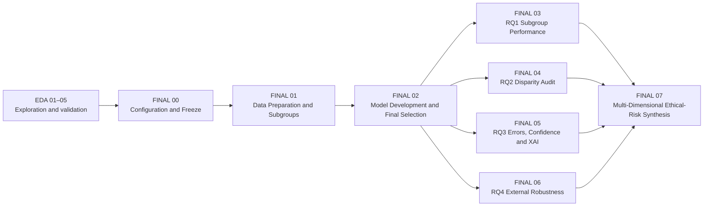
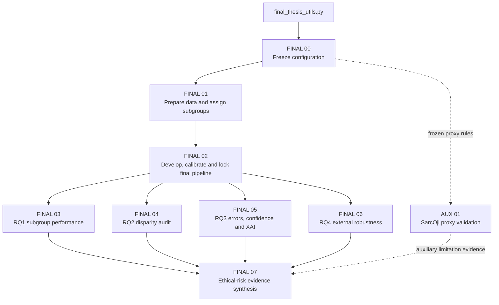
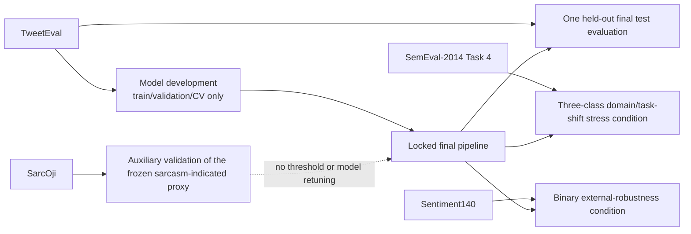

# Ethical Risk Assessment of Sentiment Analysis Models

MSc thesis implementation repository for:

**An Ethical Risk Assessment of Sentiment Analysis Models in Social Media Monitoring with a Focus on Bias, Inclusivity, and Misclassification Patterns**

Abhishek Tomar — Liverpool John Moores University — October 2026

## Repository structure

```text
Implementation/
 final_thesis_utils.py
 FINAL_00_Config_and_Freeze.ipynb
 FINAL_01_Data_Preparation_and_Subgroups.ipynb
 FINAL_02_Model_Development_and_Lock.ipynb
 FINAL_03_RQ1_Subgroup_Performance.ipynb
 FINAL_04_RQ2_Disparity_Audit.ipynb
 FINAL_05_RQ3_Errors_Confidence_XAI.ipynb
 FINAL_06_v2_RQ4_External_Robustness.ipynb
 FINAL_07_Ethical_Risk_Synthesis.ipynb
 AUX_01_SarcOji_Proxy_Validation.ipynb
 FIGURES_Regenerate.ipynb
 SENSITIVITY_PassC.ipynb

EDA/
 EDA_01_TweetEval_FINAL_v2.ipynb
 EDA_02_SemEval2014_FINAL_v2.ipynb
 EDA_03_Sentiment140_FINAL_v3.ipynb
 EDA_04_CrossDataset_FINAL_v2.ipynb
 EDA_05_SarcOji_ScopeGate_v1.ipynb

manifests/
 FINAL_RUN_MANIFEST.json
 SUBGROUP_FREEZE_CONFIG.json
 VERSION_CHECK_Table_4_1.ipynb
 VERSION_CHECK_20261012_091508.csv
 VERSION_CHECK_20261012_091508.json

figures/
 Fig3_6_class_distribution      Fig5_1_baseline_validation
 Fig3_7_post_length             Fig5_2_subgroup_macro_f1
 Fig3_8_markers                 Fig5_3_cpd
 FIGURE_VALUES.csv              Fig5_4_error_directions
                                Fig5_5_hcer_ece
                                Fig5_6_cross_dataset
 (each chart as .png and .svg)
 diagrams/                      conceptual diagrams and Figure 3.4 (.png and .svg)
  source/                       diagrams.py, fig34.py and the Graphviz .dot files

sensitivity/
 PassC_Sensitivity_Results.xlsx

tools/
 validate_repository.py          offline integrity checks for active and archived notebooks
 render_conceptual_figures.py    opt-in DOT-to-PNG/SVG renderer (dry-run by default)

.github/workflows/
 repository-integrity.yml        read-only validation on changes
 figure-3-10-sync.yml           Graphviz Figure 3.10 regeneration

audit/
 Figure_Audit_Report.md
 comparison.md
 recompute_tweeteval.py
 recompute_output.log
 official_files_md5.txt
 BEFORE_fig_5.3_as_in_V12_2_19.png
 AFTER_fig_5.3_in_V12_2_20.png
 redraw_fig_5_3.py

archive/legacy-25-experiment/   superseded 25-experiment plan; provenance only (see its README)

```

## Research workflow



## Final notebook dependency chain



## Dataset roles



## Authoritative final-run order

Run the core implementation notebooks in this order:

1. `FINAL_00_Config_and_Freeze.ipynb`
2. `FINAL_01_Data_Preparation_and_Subgroups.ipynb`
3. `FINAL_02_Model_Development_and_Lock.ipynb`
4. `FINAL_03_RQ1_Subgroup_Performance.ipynb`
5. `FINAL_04_RQ2_Disparity_Audit.ipynb`
6. `FINAL_05_RQ3_Errors_Confidence_XAI.ipynb`
7. `FINAL_06_v2_RQ4_External_Robustness.ipynb`
8. `FINAL_07_Ethical_Risk_Synthesis.ipynb`

`AUX_01_SarcOji_Proxy_Validation.ipynb` is auxiliary construct-validity/limitation evidence only; it does not tune or alter the frozen sarcasm-indicated rule.

`FIGURES_Regenerate.ipynb` is run after FINAL_07 (see *Figure regeneration* below). It reads results; it does not change any of them.

The `archive/legacy-25-experiment/` folder preserves the earlier 25-experiment plan for provenance only; none of its notebooks or results are used in the final thesis.

### Authoritative external-robustness notebooks

The repository's authoritative external-robustness implementation is `FINAL_06_v2_RQ4_External_Robustness.ipynb`, followed by the current `FINAL_07_Ethical_Risk_Synthesis.ipynb`. Earlier superseded FINAL_06/FINAL_07 variants are intentionally excluded from the active `Implementation/` folder so that the executable path cannot be confused with the final thesis run.

FINAL_06 v2 evaluates the locked source model on the frozen EDA_03 v3 Sentiment140 sample: 100,000 unique-text rows (50,000 per class), with conflicting-label duplicate texts excluded. Linguistic subgroup tagging is performed on raw `text`, whereas model prediction uses leakage-controlled `text_eval` with source-like ASCII emoticons removed. FINAL_07 consumes those corrected outputs and includes the coverage-qualified Sentiment140 subgroup results in the external-robustness evidence row.

The EDA notebooks are supporting exploratory/data-validation records and are not part of the authoritative FINAL_00–FINAL_07 dependency chain.

## Dataset roles and interpretation boundaries

- **TweetEval:** primary dataset for model development, validation-based selection and one held-out final test evaluation.
- **Sentiment140:** binary external-robustness condition. The locked three-class source pipeline is unchanged; neutral predictions are retained as errors.
- **SemEval-2014 Task 4:** three-class domain/task-shift stress condition, not clean same-task validation.
- **SarcOji:** auxiliary validation of the frozen sarcasm-indicated surface-cue proxy only.

## Source datasets (separate downloads)

The repository does not redistribute the original datasets. The primary dataset locations are:

- [TweetEval — sentiment split](https://github.com/cardiffnlp/tweeteval/tree/main/datasets/sentiment), official CardiffNLP task files.
- [Sentiment140 — Stanford original archive](https://cs.stanford.edu/people/alecmgo/trainingandtestdata.zip), used only in the external binary robustness condition.
- [SemEval-2014 Task 4 — organisers' data and tools](https://alt.qcri.org/semeval2014/task4/index.php?id=data-and-tools), the original task/dataset entry point; availability may vary.
- [SarcOji — authors' corpus](https://github.com/VanditaGroverKapila/SarcOji), used only for auxiliary sarcasm-proxy validation (the smaller SarcOji test-set repository is not the full corpus).

Acquisition, licensing and any required local preprocessing remain the responsibility of the reproducer. Reproducing the complete run also requires the matching frozen preparation artefacts or regenerating them in the documented notebook order; the checked-in code is not a self-contained data package.

## Reproducibility controls

- Random seed: `42`.
- TweetEval test data is excluded from model-family, feature and hyperparameter selection.
- External datasets are not used for source-model selection or retuning.
- Linguistic subgroup rules are frozen before final evaluation.
- `N ≥ 30` is the frozen **minimum support requirement** for quantitative subgroup reporting, not a guarantee of statistical stability; smaller groups remain exploratory/descriptive.
- `reference-unmarked` is an operational comparison group, not a demographic or protected-class baseline.
- CPD/CRR are study-specific correctness-parity descriptors; they are not presented as demographic statistical parity/disparate impact.
- SHAP/LIME evidence is local and descriptive, not causal.
- The ethical-risk synthesis remains multi-dimensional; no total risk score, low/medium/high category or overall model ranking is created.

The exact freeze values are recorded in `manifests/SUBGROUP_FREEZE_CONFIG.json`, and the executed run metadata is recorded in `manifests/FINAL_RUN_MANIFEST.json`.

## Figure regeneration

`Implementation/FIGURES_Regenerate.ipynb` redraws the thesis **data charts** — Figures 3.6, 3.7, 3.8 and 5.1 to 5.6 — from the locked outputs:

- inputs (read-only): `LJMU_FINAL_EXPERIMENT_RUN/data/tweeteval_*_final.parquet` and `LJMU_FINAL_EXPERIMENT_RUN/results/*.csv`; Figure 3.8 also loads the frozen tagger from `final_thesis_utils.py`;
- runtime outputs: each chart as a 300 dpi PNG and an SVG, plus `FIGURE_VALUES.csv`, in the Colab Drive folder `LJMU_FINAL_EXPERIMENT_RUN/figures/thesis_regenerated/`. The 63-row logged-values reference is checked in at `figures/FIGURE_VALUES.csv`; the checked-in PNG/SVG assets under `figures/` are separate publication copies and must be synchronised and verified after regeneration.

In V13 the charts were restyled for readability: light fills with dark outlines, Times New Roman text, and an SVG copy of each chart. Only the presentation changed. The data loading and the 63 logged values are identical to the previous version, so `FIGURE_VALUES.csv` is unchanged, and Figure 5.3's labels are still rounded once from the full-precision FINAL_04 values (see `audit/`).

**Figure layout and asset status (20 October 2026):** The authoritative notebook is now committed with executed chart previews, the original Figure 3.7 panel headings, no overall title for Figure 3.8, and a legend-overlap guard. Its frozen data calculations have not been changed by the figure-layout corrections. The full-resolution **Figure 3.7/3.8 PNG and SVG publication assets still need to be retrieved from the Colab output folder, compared with the 63-row values log, and synchronised** to the checked-in `figures/` copies and the thesis. Do not mistake a saved notebook preview for a verified publication asset. Historical changes are documented in `audit/Figure_Layout_Update_2026-10-20.md`.

The conceptual diagrams (workflows, frameworks and pipelines) show no measured results. They are rendered from Graphviz sources in `figures/diagrams/source/` (`diagrams.py` and `.dot` files). `fig34.py` builds Figure 3.4 from eight example records of the official TweetEval test split. Publication PNG/SVG copies reside under `figures/diagrams/`.

To regenerate existing publication diagrams **without renaming or overwriting the checked-in DOT source**, use `python tools/render_conceptual_figures.py` to preview the planned output paths, then `python tools/render_conceptual_figures.py --figure Fig3_10 --write` (or `--write` for all DOT-based diagrams) after reviewing. This requires Graphviz. The historical `figures/diagrams/source/diagrams.py` emitter writes lowercase names in its working directory; it is retained as a source-generation record, whereas the checked-in `Fig*.dot` sources and the new renderer are the preferred publication-asset workflow. Figure 3.4 has a separate data-dependent Matplotlib source.

Text in the figures is set in Times New Roman. Layout is computed with Liberation Serif, which has identical character metrics, so the figures render the same where Times New Roman is not installed.

## Sensitivity checks

`Implementation/SENSITIVITY_PassC.ipynb` runs supplementary sensitivity and construct-validation checks around the frozen final analysis (thesis Section 5.3.4, Table 5.7). It never refits a model. Before computing any alternative it reproduces the frozen subgroup assignment row for row, every locked subgroup Macro F1 value, and the locked Sentiment140 result (with both SHA-256 fingerprints verified); any mismatch stops the run.

Checks: reference-group class composition and post length (class-standardised and length-matched comparisons, and a reference group without the eight-word minimum); emoji threshold 0.03–0.10; slang threshold 0.05–0.15; precedence order; direct bootstrap intervals for each subgroup-minus-reference gap at 500 and 2,000 resamples; and Sentiment140 gap intervals with class support.

`sensitivity/PassC_Sensitivity_Results.xlsx` contains every result table, extracted from the executed notebook, with a provenance sheet. The notebook also writes the same tables as CSVs, plus the 51-term slang lexicon and a 54-post sample for manual construct checks, to `LJMU_FINAL_EXPERIMENT_RUN/results/sensitivity/`.

## Version record

`manifests/VERSION_CHECK_Table_4_1.ipynb` extracts the `pip install` commands from the final notebooks, re-runs them in a fresh Colab runtime and records the resulting library versions (`VERSION_CHECK_20261012_091508.csv` and `.json`). These are the versions reported in Table 4.1 of the thesis.

Python 3.13.15 and scikit-learn 1.6.1 come from the original run manifest. The verification runtime reproduced scikit-learn 1.6.1 but reported Python 3.13.16, a later patch release. The remaining versions were not captured at the time of the original run (the notebooks installed packages with `pip -q`), so they document the reconstructed environment, not a byte-identical record of the original one.

## Audit

`audit/` records how the thesis figures were checked:

- `recompute_tweeteval.py`, `recompute_output.log` and `official_files_md5.txt` recompute the Chapter 3 statistics from the official TweetEval release (cardiffnlp/tweeteval, `datasets/sentiment`);
- `comparison.md` compares the Chapter 5 figures with the saved cell outputs of the locked notebooks;
- `BEFORE_fig_5.3_as_in_V12_2_19.png`, `AFTER_fig_5.3_in_V12_2_20.png` and `redraw_fig_5_3.py` document the Figure 5.3 correction;
- `Figure_Audit_Report.md` summarises the result for every data figure.

## Execution environment and paths

The notebooks were executed in Google Colab with Google Drive persistence. The executed final run writes artefacts beneath:

```text
/content/drive/MyDrive/LJMU_FINAL_EXPERIMENT_RUN/
 data/
 models/
 predictions/
 results/
 figures/
 manifests/
```

The notebooks also contain the Drive file ID used to retrieve `final_thesis_utils.py` during the original Colab run. A reproducer using a different Drive layout should change the utility-loading step and/or `RUN_ROOT` while preserving the frozen methodological configuration.

## Expected outputs

The final run saves prepared data, the locked model, prediction artefacts, result tables, figures and manifests. Key externally reported outputs include the TweetEval held-out predictions, RQ1 subgroup results, five-model RQ2 disparity results, RQ3 error/confidence/XAI outputs, and RQ4 Sentiment140/SemEval robustness tables.

This repository documents the thesis implementation and reproducibility logic. It does not include a claim of universal cross-domain fairness, demographic harm, causal explanation, or a single ethical-risk score.


## Release and integrity notes — V13_13 (20 October 2026)

- The V13_13 editorial pass changed wording and Figure 3.10's explanation of the minimum-support rule, **not** the frozen research questions, four objectives, model selection, subgroup thresholds, experimental statistics or the 63 logged chart values.
- Figure 3.10's `N ≥ 30` note denotes *minimum support* for quantitative subgroup reporting, not a statistical stability guarantee. Its source is `figures/diagrams/source/Fig3_10.dot`; the PNG/SVG assets were regenerated from that source.
- The Figure 3.7/3.8 notebook now has the approved titles, labels and non-overlapping legend placement. The notebook contains the executed Colab previews. **The newer full-resolution output images have not yet been verified against and copied over the existing repository publication assets.**
- All 33 checked-in notebooks (17 active plus 16 in the provenance archive) have had account-identifying Colab executor metadata removed from the current branch, leaving their code and experimental outputs intact. Historical Git commits can retain previous metadata.
- `python tools/validate_repository.py` checks notebook structure and executor-metadata hygiene across both active and archived notebooks, frozen-manifest agreement, the 63-row figure-value inventory, expected publication assets and critical Figure 3.7/3.8 source conventions. The `Repository integrity` workflow runs these checks on relevant commits. **This is not an independent rerun of the research.**
- The `archive/legacy-25-experiment/` tree is preserved for provenance, not used to support final-thesis claims. The thesis document, private datasets, prediction artefacts and model weights remain outside this public repository.
