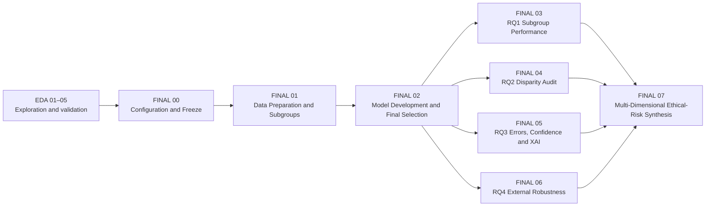
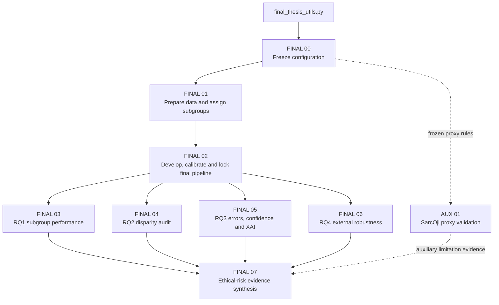
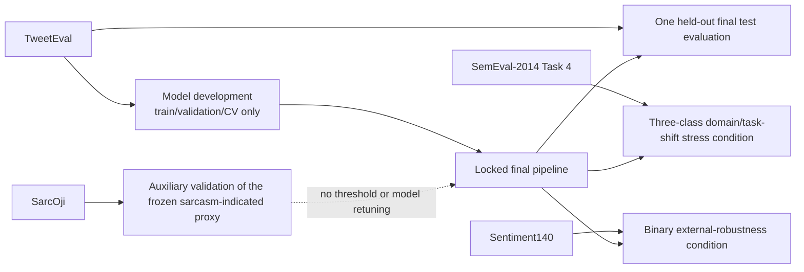

# Ethical Risk Assessment of Sentiment Analysis Models

MSc thesis implementation repository for:

**An Ethical Risk Assessment of Sentiment Analysis Models in Social Media Monitoring with a Focus on Bias, Inclusivity, and Misclassification Patterns**

Abhishek Tomar — Liverpool John Moores University — October 2026

## Repository structure

```text
Implementation/
 final_thesis_utils.py
 FINAL_00_Config_and_Freeze.ipynb
 FINAL_01_Data_Preparation_and_Subgroups.ipynb
 FINAL_02_Model_Development_and_Lock.ipynb
 FINAL_03_RQ1_Subgroup_Performance.ipynb
 FINAL_04_RQ2_Disparity_Audit.ipynb
 FINAL_05_RQ3_Errors_Confidence_XAI.ipynb
 FINAL_06_v2_RQ4_External_Robustness.ipynb
 FINAL_07_Ethical_Risk_Synthesis.ipynb
 AUX_01_SarcOji_Proxy_Validation.ipynb
 FIGURES_Regenerate.ipynb

EDA/
 EDA_01_TweetEval_FINAL_v2.ipynb
 EDA_02_SemEval2014_FINAL_v2.ipynb
 EDA_03_Sentiment140_FINAL_v3.ipynb
 EDA_04_CrossDataset_FINAL_v2.ipynb
 EDA_05_SarcOji_ScopeGate_v1.ipynb

manifests/
 FINAL_RUN_MANIFEST.json
 SUBGROUP_FREEZE_CONFIG.json
 VERSION_CHECK_Table_4_1.ipynb
 VERSION_CHECK_20261012_091508.csv
 VERSION_CHECK_20261012_091508.json

figures/
 Fig3_6_class_distribution.png      Fig5_1_baseline_validation.png
 Fig3_7_post_length.png             Fig5_2_subgroup_macro_f1.png
 Fig3_8_markers.png                 Fig5_3_cpd.png
 FIGURE_VALUES.csv                  Fig5_4_error_directions.png
                                    Fig5_5_hcer_ece.png
                                    Fig5_6_cross_dataset.png

audit/
 Figure_Audit_Report.md
 comparison.md
 recompute_tweeteval.py
 recompute_output.log
 official_files_md5.txt
 BEFORE_fig_5.3_as_in_V12_2_19.png
 AFTER_fig_5.3_in_V12_2_20.png
 redraw_fig_5_3.py
```

## Research workflow



## Final notebook dependency chain



## Dataset roles



## Authoritative final-run order

Run the core implementation notebooks in this order:

1. `FINAL_00_Config_and_Freeze.ipynb`
2. `FINAL_01_Data_Preparation_and_Subgroups.ipynb`
3. `FINAL_02_Model_Development_and_Lock.ipynb`
4. `FINAL_03_RQ1_Subgroup_Performance.ipynb`
5. `FINAL_04_RQ2_Disparity_Audit.ipynb`
6. `FINAL_05_RQ3_Errors_Confidence_XAI.ipynb`
7. `FINAL_06_v2_RQ4_External_Robustness.ipynb`
8. `FINAL_07_Ethical_Risk_Synthesis.ipynb`

`AUX_01_SarcOji_Proxy_Validation.ipynb` is auxiliary construct-validity/limitation evidence only; it does not tune or alter the frozen sarcasm-indicated rule.

`FIGURES_Regenerate.ipynb` is run after FINAL_07 (see *Figure regeneration* below). It reads results; it does not change any of them.

### Authoritative external-robustness notebooks

The repository's authoritative external-robustness implementation is `FINAL_06_v2_RQ4_External_Robustness.ipynb`, followed by the current `FINAL_07_Ethical_Risk_Synthesis.ipynb`. Earlier superseded FINAL_06/FINAL_07 variants are intentionally excluded from the active `Implementation/` folder so that the executable path cannot be confused with the final thesis run.

FINAL_06 v2 evaluates the locked source model on the frozen EDA_03 v3 Sentiment140 sample: 100,000 unique-text rows (50,000 per class), with conflicting-label duplicate texts excluded. Linguistic subgroup tagging is performed on raw `text`, whereas model prediction uses leakage-controlled `text_eval` with source-like ASCII emoticons removed. FINAL_07 consumes those corrected outputs and includes the coverage-qualified Sentiment140 subgroup results in the external-robustness evidence row.

The EDA notebooks are supporting exploratory/data-validation records and are not part of the authoritative FINAL_00–FINAL_07 dependency chain.

## Dataset roles and interpretation boundaries

- **TweetEval:** primary dataset for model development, validation-based selection and one held-out final test evaluation.
- **Sentiment140:** binary external-robustness condition. The locked three-class source pipeline is unchanged; neutral predictions are retained as errors.
- **SemEval-2014 Task 4:** three-class domain/task-shift stress condition, not clean same-task validation.
- **SarcOji:** auxiliary validation of the frozen sarcasm-indicated surface-cue proxy only.

## Reproducibility controls

- Random seed: `42`.
- TweetEval test data is excluded from model-family, feature and hyperparameter selection.
- External datasets are not used for source-model selection or retuning.
- Linguistic subgroup rules are frozen before final evaluation.
- Stable subgroup interpretation requires `N >= 30`; smaller groups remain exploratory/descriptive.
- `reference-unmarked` is an operational comparison group, not a demographic or protected-class baseline.
- CPD/CRR are study-specific correctness-parity descriptors; they are not presented as demographic statistical parity/disparate impact.
- SHAP/LIME evidence is local and descriptive, not causal.
- The ethical-risk synthesis remains multi-dimensional; no total risk score, low/medium/high category or overall model ranking is created.

The exact freeze values are recorded in `manifests/SUBGROUP_FREEZE_CONFIG.json`, and the executed run metadata is recorded in `manifests/FINAL_RUN_MANIFEST.json`.

## Figure regeneration

`Implementation/FIGURES_Regenerate.ipynb` redraws the thesis **data charts** — Figures 3.6, 3.7, 3.8 and 5.1 to 5.6 — from the locked outputs:

- inputs (read-only): `LJMU_FINAL_EXPERIMENT_RUN/data/tweeteval_*_final.parquet` and `LJMU_FINAL_EXPERIMENT_RUN/results/*.csv`; Figure 3.8 also loads the frozen tagger from `final_thesis_utils.py`;
- outputs: the nine PNGs and `FIGURE_VALUES.csv` in `figures/`. The CSV lists all 63 plotted values, so every number in a chart can be compared with the result table it came from.

The copy stored here is the executed notebook (outputs included). Figure 5.3 was redrawn from the full-precision FINAL_04 values after two of its labels were found to be double-rounded (see `audit/`).

The thesis also contains conceptual diagrams (workflows, frameworks, pipelines). They show no measured data and are not generated by code. Figure 3.4 (sample records) is an image of eight records from the official TweetEval test split; it was verified against the official files, as described in `audit/`.

## Version record

`manifests/VERSION_CHECK_Table_4_1.ipynb` extracts the `pip install` commands from the final notebooks, re-runs them in a fresh Colab runtime and records the resulting library versions (`VERSION_CHECK_20261012_091508.csv` and `.json`). These are the versions reported in Table 4.1 of the thesis.

Python 3.13.15 and scikit-learn 1.6.1 come from the original run manifest. The verification runtime reproduced scikit-learn 1.6.1 but reported Python 3.13.16, a later patch release. The remaining versions were not captured at the time of the original run (the notebooks installed packages with `pip -q`), so they document the reconstructed environment, not a byte-identical record of the original one.

## Audit

`audit/` records how the thesis figures were checked:

- `recompute_tweeteval.py`, `recompute_output.log` and `official_files_md5.txt` recompute the Chapter 3 statistics from the official TweetEval release (cardiffnlp/tweeteval, `datasets/sentiment`);
- `comparison.md` compares the Chapter 5 figures with the saved cell outputs of the locked notebooks;
- `BEFORE_fig_5.3_as_in_V12_2_19.png`, `AFTER_fig_5.3_in_V12_2_20.png` and `redraw_fig_5_3.py` document the Figure 5.3 correction;
- `Figure_Audit_Report.md` summarises the result for every data figure.

## Execution environment and paths

The notebooks were executed in Google Colab with Google Drive persistence. The executed final run writes artefacts beneath:

```text
/content/drive/MyDrive/LJMU_FINAL_EXPERIMENT_RUN/
 data/
 models/
 predictions/
 results/
 figures/
 manifests/
```

The notebooks also contain the Drive file ID used to retrieve `final_thesis_utils.py` during the original Colab run. A reproducer using a different Drive layout should change the utility-loading step and/or `RUN_ROOT` while preserving the frozen methodological configuration.

## Expected outputs

The final run saves prepared data, the locked model, prediction artefacts, result tables, figures and manifests. Key externally reported outputs include the TweetEval held-out predictions, RQ1 subgroup results, five-model RQ2 disparity results, RQ3 error/confidence/XAI outputs, and RQ4 Sentiment140/SemEval robustness tables.

This repository documents the thesis implementation and reproducibility logic. It does not include a claim of universal cross-domain fairness, demographic harm, causal explanation, or a single ethical-risk score.
